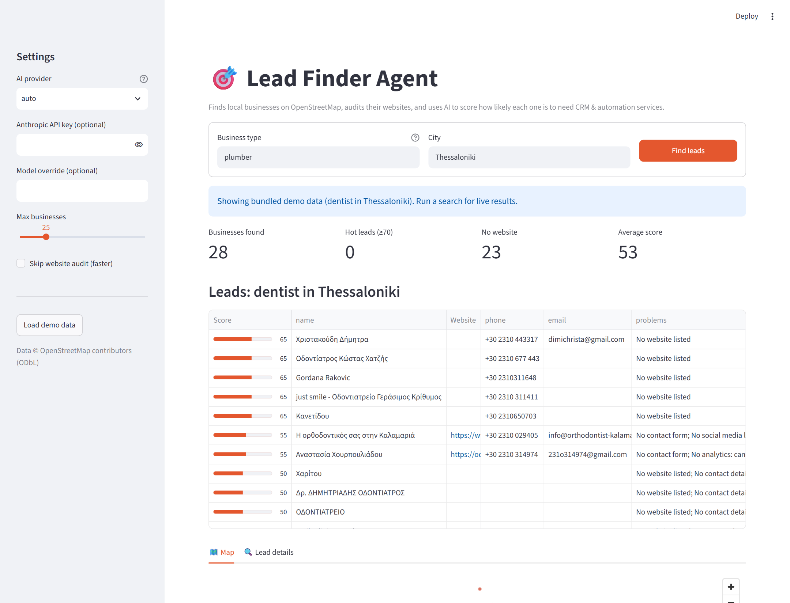

# 🎯 Lead Finder Agent

[](https://github.com/OWNER/lead-finder-agent/actions/workflows/ci.yml)


An AI agent that turns **"plumbers in Thessaloniki"** into a ranked list of sales leads.

It finds local businesses on **OpenStreetMap**, audits each business's website (HTTPS, mobile,
contact form, online booking, chat, analytics, CMS, outdated copyright, SEO basics, socials, and the
contact page too), and asks an **LLM** to score how likely the business
is to need CRM / automation services, along with the problems it found and a personalised cold-email opener.

Runs **with zero API keys** (free OpenStreetMap data + offline rule-based scoring). Add a Claude,
OpenAI or local Ollama model to get AI-written analysis.



## How it works

```
"dentist" + "Larissa"
      │
      ▼
 1. Discover   Nominatim geocodes the city → Overpass API finds matching OSM businesses
 2. Enrich     async fetch of each homepage (+ contact page) → website signals
 3. Analyze    pluggable analyzer: Claude | OpenAI | Ollama | rules → score 0-100 + problems + pitch
 4. Export     ranked CSV / JSON, table in the terminal, or the Streamlit dashboard
```

| Module | Role |
| --- | --- |
| `leadfinder/sources/osm.py` | Geocoding, Overpass query builder, mirror fallback + retries |
| `leadfinder/cache.py` | 24h disk cache for OSM responses (`~/.cache/leadfinder`) |
| `leadfinder/sources/categories.py` | "plumber" → `craft=plumber`, aliases, name-search fallback |
| `leadfinder/enrich.py` | Concurrent website audit with httpx + BeautifulSoup |
| `leadfinder/llm/` | `Analyzer` interface, providers, JSON validation, rule-based fallback |
| `leadfinder/agent.py` | Orchestrates the pipeline with progress callbacks |
| `leadfinder/demo.py` | Bundled sample results for offline demos |
| `app.py` | Streamlit UI: metrics, score table, map, lead details, CSV download |

## Quick start

```bash
git clone https://github.com/<you>/lead-finder-agent && cd lead-finder-agent
python -m venv .venv && source .venv/bin/activate   # Windows: .venv\Scripts\activate
pip install -e ".[all]"
```

### CLI

```bash
leadfinder search plumber --city Thessaloniki
leadfinder search dentist --city "Larissa, Greece" --limit 50 --provider claude -o dentists.json
leadfinder search "pizza" --city Milan --skip-websites   # unknown terms search business names
leadfinder categories                                    # list built-in categories
leadfinder demo                                          # sample results, no network
leadfinder clear-cache
```

### Web app

```bash
streamlit run app.py
```

No network? Click **Load demo data** in the sidebar.

### Docker

```bash
docker build -t lead-finder .
docker run -p 8501:8501 --env-file .env lead-finder   # open http://localhost:8501
```

### Deploy free on Streamlit Community Cloud

Push to GitHub, create an app at [share.streamlit.io](https://share.streamlit.io) pointing at `app.py`,
and add `LEADFINDER_DEMO = "1"` (and optionally `ANTHROPIC_API_KEY`) under **Secrets**, so
visitors land on sample results instantly.

## AI providers

| `--provider` | Needs | Notes |
| --- | --- | --- |
| `auto` (default) | – | Claude if `ANTHROPIC_API_KEY` is set, else OpenAI if `OPENAI_API_KEY` is set, else rules |
| `rules` | nothing | Deterministic, offline scoring |
| `claude` | `ANTHROPIC_API_KEY` | Default model `claude-sonnet-5-5` (`CLAUDE_MODEL` to override) |
| `openai` | `OPENAI_API_KEY` | `OPENAI_MODEL` to override |
| `ollama` | [Ollama](https://ollama.com) running locally | Free; `OLLAMA_MODEL` (default `llama3.1`) |

Copy `.env.example` to `.env` to configure. If an LLM returns invalid JSON or errors, that lead is
scored by the rules engine instead, and the CLI/UI warns you.

## Development

```bash
pip install -e ".[all,dev]"
pytest              # all HTTP is mocked with respx: fast and offline
ruff check . && ruff format --check .
```

| Env var | Effect |
| --- | --- |
| `LEADFINDER_CACHE_DIR` | Where OSM responses are cached |
| `LEADFINDER_NO_CACHE=1` | Disable the cache |
| `LEADFINDER_DEMO=1` | Streamlit app opens with demo data |

## Being a good citizen

OpenStreetMap's servers are free community infrastructure. The agent sends a descriptive
User-Agent, runs **one** Overpass query per search, only fetches each business's homepage (and contact page), and
caps concurrent requests. Results are cached for 24 h, so repeat searches don't hit the servers again. Please respect the
[Nominatim](https://operations.osmfoundation.org/policies/nominatim/) usage policy, and local
regulations (e.g. GDPR) when contacting businesses.

Data © OpenStreetMap contributors, ODbL.

## License

MIT
